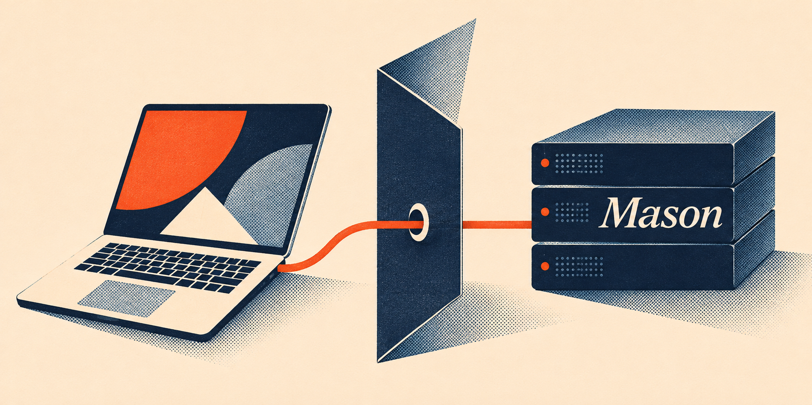

# 用魔法打败魔法！我让 Antigravity 的 Claude Opus 5.5 给部署 Claude Code 的东京服务器做体检

**Mason 的云端开发实作手记** · Ubuntu 24.04 / Windows / Claude Code / code-server

我给 Claude Code 建了独立的 Linux 账号，网页只监听回环地址，SSH 也关了密码登录。用 Google Antigravity 里的 Claude Opus 5.5 复查时，却看见一条为装依赖留下的免密 sudo 规则。后来我改好了办公电脑的 SSH 线路，服务器上仍留着家里电脑发起的连接。这两处遗漏，是这份手册的起点。

## 从哪里开始

| 你现在想做什么 | 看这里 |
|---|---|
| 弄清为什么上了云还要检查权限 | [第一版部署与七处遗漏](docs/playbook.md#initial-audit) |
| 跟着这次改造从头走一遍 | [完整实战手册](docs/playbook.md) |
| 复核自己已经搭好的环境 | [20 项可勾选核查清单](docs/checklist.md) |
| 让自己的 AI 帮忙读一段脱敏的配置输出 | [可直接复制的复核提示词](docs/review-prompt.md) |

## 九步为什么这样排

**先查云端工作进程。** 在网页终端确认 Claude 以谁的身份运行，再分别看这个账号能连接什么、网页和手机会话实际继承了哪些限制。[① 工作账号](docs/playbook.md#step-1) · [② 出站访问](docs/playbook.md#step-2) · [③ 网页与手机进程](docs/playbook.md#step-3)

**再把日常工作接回来。** 办公电脑的隧道先为编辑器和文件服务限定两个目标。复查时浮现了家里另一条连接；查清它的来源以后，再把 WebDAV 接入原先预留的端口，最后处理运行在本机的浏览器。[④ 办公隧道](docs/playbook.md#step-4) · [⑤ 家庭 SSH](docs/playbook.md#step-5) · [⑥ Windows Z: 盘](docs/playbook.md#step-6) · [⑦ 工作浏览器](docs/playbook.md#step-7)

**最后收尾并验收。** 新入口能用后再停旧服务，核对同机目录与历史资料。验收同时看两件事：工作账号能否被挡在受限目录外，以及它能否照常保存项目、从手机接回会话。[⑧ 旧入口与目录 ACL](docs/playbook.md#step-8) · [⑨ 真实会话验收](docs/playbook.md#step-9)

## 一个容易误判的结果

`sudo -n true` 失败，只能说明这条命令当时没能免交互执行。要知道工作账号到底还有哪些授权，得从管理员终端查看它的完整授权列表。同样，`ssh -G` 能解释一个新连接将采用的配置；要判断现存连接的来源，还要结合两端的会话记录。手册把每一项配置和相应的证据放在同一步里。

实践与署名 / Mason。文字整理及配图使用了 AI 辅助。转载请先联系作者取得授权，引用请注明 Mason 及本仓库链接。
