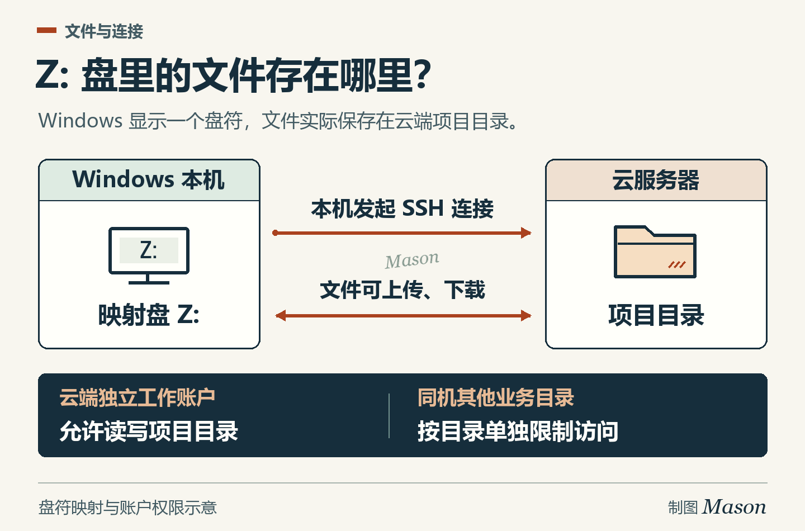
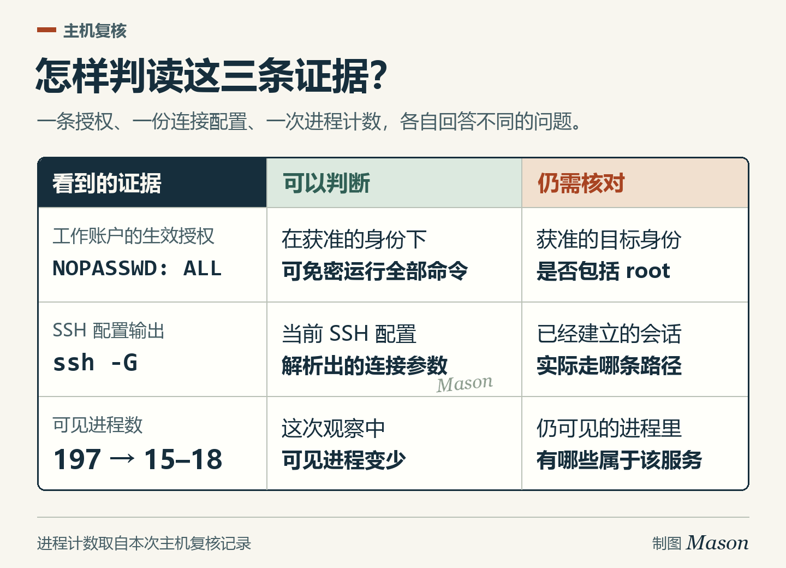

# 用魔法打败魔法！我让 Antigravity 的 Claude Opus 5.5 给部署 Claude Code 的东京服务器做体检

Mason · 云端开发实作手记

为了能放心稳定地使用 Claude Code，我把它和网页版编辑器 code-server 搬到东京的一台 Ubuntu 24.04 服务器上。我的打算很简单：让它在云端改项目、跑测试，私人资料照旧留在自己的电脑上。第一版给 Claude 建了独立的 Linux 账号，网页只监听回环地址，SSH 也关了密码登录。到这里，我以为隔离已经做得差不多了。

后来，我在 **Google Antigravity** 里选了 **Claude Opus 5.5**，用红蓝对抗的思路复查这套部署。红方问：“如果 Claude 已经在服务器里跑起来，操作系统究竟允许它做什么？”蓝方就去看这个工作账号的实际授权。为了装依赖，我曾给它留过一条 `NOPASSWD: ALL`。只要这条规则还在，账号即使叫“普通用户”，也可以免密以管理员身份运行命令。

这个发现改变了我接下来的查法。我从 Claude 真正运行的账号出发，顺着它能看到的进程、能连接的服务和能读写的目录往外查。**有些遗漏是在改造途中才暴露的。** 比如，直到我改完办公电脑的 SSH 线路，才注意到家里电脑还有一条独立连接。下文先交代这台机器最终需要守住哪些边界，再回到第一版看问题如何浮现。九步配置按依赖关系展开，具体发现的先后在相应步骤里说明。

<a name="threat-model"></a>

## 一、底层原理与威胁模型：我们到底在防什么？

把 AI 编程助手当作一名临时加入项目的工程师，我希望它能在自己的工作区正常交付，也希望它离开这个目录就没有额外特权。对我的部署而言，“环境纯净度”具体落在五个问题上。

1. **代码以谁的身份执行？** 本机直接启动的 CLI 通常继承启动账号的权限。迁到 VPS 后，执行命令的是服务器账号。它的附加组、sudo 授权和目录权限，决定了它在云端还能做什么。
2. **网络连接是谁发起的，又通向哪里？** 办公电脑通过 SSH 隧道打开网页；家里电脑还有独立的 Codex 远程项目。两条连接可以使用不同账号、密钥和配置。Tailscale 连着哪些设备、哪些方向允许访问，也要另外看策略。
3. **同机还有什么需要保护？** 我的服务器还运行其他业务和监控。Claude 需要读写项目文件，管理员需要运维，监控账号需要经过某些目录。给其中一方收权限时，另外两方还得照常工作。
4. **哪些信息留在本机浏览器？** code-server 的终端命令在云端执行，打开网页的浏览器和部分扩展前端仍在本机运行。工作会话、已安装扩展、站点权限，以及页面可读取的语言、时区等，都属于客户端一侧。
5. **哪些日常操作必须保留？** 我还希望 Windows 里能拖文件、家里的开发项目能继续连、出门能用手机接回会话。这三项后来都成了验收条件。把所有入口都关掉，很容易得到一份“全部访问失败”的记录，却没法再干活。

### 最终落地的云端沙箱目标架构

先看改造完成后的样子。**办公电脑**通过 SSH 本地转发访问云端的两个回环服务：code-server 给浏览器提供编辑器，WebDAV 把项目目录映射成 Windows 的 Z: 盘。这条 SSH 连接由电脑发起，文件可以上传和下载。**家里电脑**上的 Codex 有自己的连接和授权。**手机**接回云端已有的 Claude 会话，命令仍在服务器上执行。

**服务器**上，管理员安装软件和维护服务，工作账号 `claudeops` 负责项目。SSH 管入口，Linux 账号和 ACL 管文件，systemd 管每个服务的运行环境，nftables 管指定账号可以到达的网络目标。后面的九步就是把这些约束分别落实到它们真正起作用的地方。



*图 1　架构里最容易画错的两根箭头：电脑发起 SSH 连接，文件可以上传和下载。制图 / Mason*

<a name="initial-audit"></a>

## 二、前车之鉴：第一阶段「常规隔离」做对了什么，又为什么差点破功？

回到最初部署时，我先解决的是“谁能从外面进来”。代码拉取、编译和 Claude 终端都搬到了云端；code-server 只监听 `127.0.0.1:9090`，浏览器最初通过 Tailscale Serve 的私有 HTTPS 入口访问。公网 SSH 由主机防火墙和密钥认证把关。

对“进来以后能做什么”，第一版也设了两道限制：用独立账号 `claudeops` 跑工作任务，把管理员家目录设为 `0750`；在 Claude 的应用设置里限定工具权限，并关闭用不到的遥测。

这两层要分开验。公网打不开编辑器，只能说明入口受限。打开网页终端后，进程已经在服务器里面，此时决定它能做什么的，是系统给它的权限。顺着这个区别往下查，我把整轮复核中陆续遇到的七处遗漏汇成了下表。右栏列的是处理位置；其中家里电脑那条 SSH 连接，发现得比表里看起来要晚。

| 第一版留下的疑点 | 我的环境里实际看到了什么 | 对应改造 |
|---|---|---|
| 工作账号还有免密 sudo | 装包时留下的规则允许以管理员身份运行任意命令；编辑器内的禁止列表没有撤销系统授权。 | 步骤一 |
| 组网控制接口对工作账号可见 | 本机套接字模式为 `0666`，工作账号能取得不需要的节点状态。可读哪些状态、能否管理节点要分别判断。 | 步骤一 |
| 云端和个人设备处在同一虚拟网络 | 工作账号有机会访问本不需要的网内服务；两台电脑对入站访问的需求又不同。 | 步骤二 |
| 家里另有一条 SSH 长连接 | Codex 远程项目使用自己的 SSH 配置；三个月约 320 次自动登录，检查当时还看到了 3 个回环监听。 | 步骤二、五 |
| 线路体验差，连接来源也留在登录记录里 | 直连时测得 21～27 KB/s。历史日志有审计价值，但普通工作账号没有读取这些记录的业务需要。 | 步骤一、四 |
| 日常浏览器兼作工作浏览器 | 扩展、登录状态和站点权限混在同一个配置中；页面还可能读取本机的语言、时区等属性。 | 步骤七 |
| 手机会话和旧文件没有纳入同一套约束 | 手工 tmux 启动的会话与网页服务的进程视图不同；早期会话副本、Git 配置和部分同机目录还带着不必要的信息。 | 步骤三、八 |

为什么七处遗漏要拆成九步？以家里的 SSH 为例，客户端为什么会连上来，要去家里电脑上查（步骤五）；云端工作账号能不能碰这条会话的入口，却要在服务器上管（步骤二）。反过来，Z: 盘解决的是另一类需求：权限收紧以后，我还得有地方交接文件。把问题和改动这样对上，后面的步骤就有了先后。

<a name="hardening"></a>

## 三、九步搭建云端沙箱：做什么、为什么、怎么做、如何验收

**第一至三步从服务器内部开始。** 先收回工作账号多余的授权，再限定这个身份能连到哪里，最后把网页端和手机端启动的进程都放进相应的服务约束里。

**第四至七步把日常工作接回来。** 先定办公电脑的 SSH 入口。正是在核对这条新连接时，我发现了家里电脑的旧会话。两台电脑的路径分清后，再沿办公隧道接上 Z: 盘，并单独处理运行在本机的浏览器。

**第八、九步收尾。** 新入口能用以后，再停旧入口、收紧旧目录。最后从真实工作会话复核两类结果：该拒绝的访问被挡住，原来要做的事仍然做得成。

<a name="step-1"></a>

### 步骤一　收回沙箱账号的特权，限制管理接口和登录记录的读取权限

**做什么（What）**　撤销 `claudeops` 的 `sudo` 权限，限制它访问 Tailscale 的本地管理接口和系统登录记录。同时关闭 `code-server` 自身遥测，清理已经不用的扩展。

**为什么（Why）**　我专门给 Claude 建了账号，却为装包方便留下了 `NOPASSWD: ALL`。这意味着就算 `/home/ubuntu` 的目录权限设得再仔细，这个账号仍有权以管理员身份运行命令。另外两处容易漏掉的地方是守护进程和登录记录。前者知道组网设备的信息，后者记着登录来源。开发工作不需要读取这些数据，管理员排障却用得上。

**怎么做（How）**

1. **先查授权，再收回。** 在这台机器上，授权文件是 `/etc/sudoers.d/90-claudeops`。我备份后移走了这条安装时留下的规则。管理账号可以用下面的命令查看当前主机为 `claudeops` 汇总出的授权，包括经用户组得到的权限。只删除一个文件，未必已经撤完。

```bash
sudo -l -U claudeops
```

2. **让管理账号继续使用 Tailscale。** 我新建了 `tsadmin` 组，只把需要从本机管理 Tailscale 的账号加入。下面是 `/etc/systemd/system/tailscaled.service.d/10-restrict-socket.conf` 的内容。服务启动后，管理员所属组有权遍历套接字目录，开发账号进不去。在沿用这段配置前，先确认本机套接字确实位于这个目录，以及哪些运维工具需要使用它。

```ini
[Service]
ExecStartPost=/bin/chgrp tsadmin /run/tailscale
ExecStartPost=/bin/chmod 0750 /run/tailscale
```

3. **保留登录记录，收紧读取范围。** 我核查了 `wtmp`、`btmp`、`lastlog` 和 `utmp` 的所有者、所属组和读取权限，也检查了重启后的文件创建规则与日志轮转规则。各发行版的默认权限、写入进程可能不同，尤其要保住失败登录记录原有的限制，以及管理员审计、登录程序写记录这两项功能。

4. **检查编辑器自己的设置。** 我在 `~/.config/code-server/config.yaml` 里加了 `disable-telemetry: true`，并在该用户的编辑器设置中写入 `"telemetry.telemetryLevel": "off"`。第三方扩展有自己的设置，需按实际启用的扩展另查。

**效果与验证（Result）**　在我的记录里，换回 `ubuntu` 仍能运维；换成 `claudeops` 后，`tailscale status` 和 `last -i` 都没有再给出原来的设备或登录记录。`sudo -n true` 也失败了。这里要分清，`-n` 表示不交互询问密码，这一次失败只能说明该命令没能免交互执行；判断还有没有别的授权，要看前面的 `sudo -l -U claudeops`。

<a name="step-2"></a>

### 步骤二　按 UID 收紧出站访问，给办公电脑打开 Shields Up

**做什么（What）**　上一步收回了管理员权限，但普通账号本来就可以发起网络连接。所以我接着在服务器上部署 `claude-guard.service`，让 `nftables` 按套接字所属用户过滤出站流量。办公电脑本身不需要接受尾网的主动连接，我在这一端另外开启了 Tailscale 的 `Shields Up`。

**为什么（Why）**　家里电脑和办公电脑的需求不同。出门时我会用平板远程桌面连回家里的电脑，直接在家里打开 `Shields Up` 会把自己的入口也关掉。同一台服务器上，另一个账号 `codexops` 还要维持正常的远程开发会话。最合适的切入点是服务器上的 `claudeops`，只给它收紧出站权限。

**怎么做（How）**　这台机器上 `claudeops` 的 UID 恰好是 `1002`。换到另一台主机，先用 `id -u claudeops` 确认，不要把数字照搬过去。我的规则分两部分。

- **尾网设备。** 对这个 UID 保留必要的 Tailscale DNS 查询（我用的地址是 `100.100.100.100` 和 `fd7a:115c:a1e0::53`），拒绝访问其余的尾网 IPv4、IPv6 地址段。读者配置 DNS 例外时，要把目的地址与目的端口一起限定为 DNS 所需的 UDP/TCP 53：这个服务地址还承载其他本地功能。若尾网还发布了家庭局域网的子网路由，按实际路由另列范围。[Tailscale 保留地址说明](https://tailscale.com/docs/reference/reserved-ip-addresses)
- **同机的转发端口。** 这里写的是最终规则。它还覆盖了其他远程开发会话在服务器回环地址上的转发入口。为什么连回环地址也要管，是后来追查家庭连接才弄清的，经过放在步骤五。我的守护服务每两秒更新一次端口集合，刷新之间有时间差。能固定并核对转发目的地的入口，优先在服务配置里明确限制。

办公电脑侧，`tailscale set --shields-up=true` 用于拒绝来自尾网的主动入站连接。仍需从其他设备访问的机器，应按设备、方向和服务配置尾网访问策略。

**效果与验证（Result）**　记录中，`claudeops` 对家庭远程桌面、家庭和办公文件共享，以及当时那个本机转发端口的检查都被拦截。对原本应放行的入口，我换回管理账号作了连通对照。这里能回答的是“这个用户能不能到达这几个目标”；办公电脑启用 `Shields Up` 后，也要按它实际生效的入站策略理解结果。

<a name="step-3"></a>

### 步骤三　把网页终端和手机遥控放进同样的 systemd 保护范围

**做什么（What）**　网络规则可以按 UID 生效，systemd 的进程和目录限制却跟着启动服务走。同样叫 `claudeops`，从网页里打开终端和从手机接回一个手工启动的 `tmux`，看到的环境可能不同。因此我给 `code-server`、`cloudcli` 加上 systemd 保护，也把手机使用的 `claude remote-control` 迁入独立的 `claude-remote-control.service`。

**为什么（Why）**　最初在服务里运行 `ps` 时，我能看见其他账号的进程，个别命令行参数里甚至带有邮箱。`ProtectProc=invisible` 可以通过服务的 `/proc` 视图隐藏其他用户的进程；同一个 UID 启动的其他服务仍可能可见。另一个问题是入口不止一个：只加固网页版，手机续聊仍会进入原来那套启动环境。

**怎么做（How）**　下面是 `/etc/systemd/system/code-server-claudeops.service.d/hardening.conf` 的配置。主服务已经以普通用户 `claudeops` 运行，路径按这台主机填写。

```ini
[Service]
UMask=0077
ProtectProc=invisible
NoNewPrivileges=true
CapabilityBoundingSet=
AmbientCapabilities=
PrivateTmp=true
PrivateDevices=true
ProtectSystem=full
ProtectKernelTunables=true
ProtectKernelModules=true
ProtectKernelLogs=true
ProtectControlGroups=true
ProtectClock=true
RestrictSUIDSGID=true
LockPersonality=true
RestrictRealtime=true
SystemCallArchitectures=native
InaccessiblePaths=/run/tailscale /home/ubuntu /home/codexops
```

其中，`NoNewPrivileges=true` 限制通过执行新程序获得额外特权；`ProtectSystem=full` 将包括 `/etc` 在内的一组系统目录以只读方式呈现；`InaccessiblePaths` 则明确列出这个服务不应进入的路径。工作区仍需正常读写。

手机端沿用同一个服务账号和工作区，并把 `remote-control` 配置放到 `/etc/claude/remote-control-settings.json`，由 `root` 持有、`claudeops` 组只读（`0440`）。我保留了原先的 `tmux` 使用习惯，下面是这个 unit 与网页服务不同的启动部分。原 unit 同样配置了上面的进程、设备、系统目录和特权限制；为了让管理员从宿主机接回 `tmux` 排障，手机这一项保留共用的临时目录。

```ini
[Service]
Type=forking
User=claudeops
Group=claudeops
WorkingDirectory=/srv/claude-workspaces
Environment=HOME=/home/claudeops
ExecStart=/usr/bin/tmux -L claude-mobile new-session -d -s remote-claude -x 116 -y 30 -c /srv/claude-workspaces "exec /home/claudeops/.local/bin/claude remote-control --name 'Cloud Claude Code' --capacity 1 --settings /etc/claude/remote-control-settings.json"
ExecStop=/usr/bin/tmux -L claude-mobile kill-server
Restart=always
RestartSec=10
```

要看 systemd 管理器为正在排查的服务记录了什么，可以先读这几项，再分别从网页和手机入口验收所需的功能。

```bash
systemctl show code-server-claudeops.service -p ActiveState -p MainPID -p User -p ProtectProc -p NoNewPrivileges
```

**效果与验证（Result）**　我对照了改造前和两个服务的挂载视图，可见进程数从 **197 个降到 15～18 个**，进程命令行里的邮箱匹配从 **2 处降到 0 处**，服务账号尝试改写那份配置文件时被拒绝。开发侧，Node、Python、Git 和 Playwright 仍能运行；手机可以重连原会话，服务器重启后服务也会拉起。进程数随当时的负载变化，没有必要把“18 个”当成别人的验收线。

<a name="step-4"></a>

### 步骤四　限制 SSH 隧道账号可以转发的目标，记录线路调整前后的速度

**做什么（What）**　前三步从云端工作进程这一侧检查权限。现在换到办公电脑这一端：我要打开编辑器，还要交接文件，实际只需要两个转发目标。我给这条隧道建了专用账号 `tunnelonly`，用 `9090` 连接已有的编辑器，为步骤六的 WebDAV 预留 `9091`。办公线路的速度也在这次一起调整，授权和测速分别验收。

**为什么（Why）**　原来晚高峰加载一次工作区要等很久，当时测得吞吐 **21～27 KB/s**。改善体验只需要让电脑连到两个服务，没必要让这个隧道账号同时获得交互终端或任意目的地址的转发权限。“本地转发”说的是监听和发起请求的一侧，建立后的 SSH 会话里，数据仍可双向传输。

**怎么做（How）**　我把 `tunnelonly` 的登录 shell 设为 `/usr/sbin/nologin`，并给它配了独立公钥，只把公钥放进由管理员维护的 `/etc/ssh/tunnelonly_authorized_keys`。下面按“只承担转发”的用途整理服务端 `sshd_config` 示例，`9090` 和 `9091` 是这台 VPS 的目标端口。

```sshconfig
Match User tunnelonly
    AuthorizedKeysFile /etc/ssh/tunnelonly_authorized_keys
    PasswordAuthentication no
    KbdInteractiveAuthentication no
    MaxSessions 0
    PermitTTY no
    X11Forwarding no
    AllowAgentForwarding no
    AllowStreamLocalForwarding no
    GatewayPorts no
    AllowTcpForwarding local
    PermitOpen 127.0.0.1:9090 127.0.0.1:9091
```

示例中的 `MaxSessions 0` 禁用这个账号的 shell、登录及子系统会话，例如 SFTP，同时保留列入许可范围的转发。[OpenSSH 对 MaxSessions 的说明](https://man.openbsd.org/sshd_config#MaxSessions)

改动前后保留管理员会话，先用 `sudo sshd -t` 检查语法，再用 `sudo sshd -T -C user=tunnelonly,host=localhost,addr=127.0.0.1` 查看给定连接条件下的有效值；有额外主机或来源匹配条件时，换成自己的实际值。确认后再重新加载 SSH 服务。

客户端的两个映射都绑定在本机回环地址，供这台电脑上的浏览器和文件管理器使用。配置好后，运行 `ssh -N claude-code-tunnel` 建立专用隧道，`-N` 表示不请求远程命令。以下是主机配置中与授权和转发有关的部分。

```sshconfig
Host claude-code-tunnel
    HostName 203.0.113.10
    User tunnelonly
    IdentityFile ~/.ssh/id_ed25519_claude_tunnel
    IdentitiesOnly yes
    ForwardAgent no
    ForwardX11 no
    ExitOnForwardFailure yes
    LocalForward 127.0.0.1:19090 127.0.0.1:9090
    LocalForward 127.0.0.1:19091 127.0.0.1:9091
```

`203.0.113.10` 是文档示例地址。`ExitOnForwardFailure` 管的是请求的转发能否建立，例如本地监听端口已被占用；它并不检查每次打开网页时最终服务能否应答。线路方面，我在这台机器的 `/etc/sysctl.d/99-bbr.conf` 记录了 `net.core.default_qdisc=fq` 和 `net.ipv4.tcp_congestion_control=bbr`。这属于性能调整，应和 SSH 授权分开验收。

**效果与验证（Result）**　办公电脑这条线路改好后，我记到的吞吐是 **1.48 MB/s**，此前晚高峰约 **21～27 KB/s**。按 25 KB/s 粗算，提升接近 60 倍。线路和服务端拥塞控制同时变化，只凭这次测量分不出 BBR 单独贡献了多少。另一次线路不可用时，SSH 以 `255` 退出；这只说明那次连接失败。

到这里，我知道办公端变快了，却还不知道另外一件事：**服务器上现有的 SSH 连接，是否都来自我刚改过的入口？** 我回头看了当时的连接表。

<a name="step-5"></a>

### 步骤五　追查家里电脑那条仍在直连的远程开发会话

**做什么（What）**　连接表里仍有一条来自家庭宽带的 SSH 长连接。我先回看认证日志：近三个月累计约 **320 次登录**，时段与家里电脑开机自动连接相符。再看检查当时的监听状态，服务器回环地址上还有 **3 个高位端口**。登录次数是回看三个月日志得出的，监听端口数来自当时的快照。要确定是哪项工具建立了这条连接，还得回到客户端去核对。

**为什么（Why）**　我对照了家里电脑的 SSH 进程树、服务端的 `codex app-server proxy` 和使用的公钥，才把这条连接归到家里电脑的 Codex 远程项目。它调用系统自带的 `ssh.exe`，读取自己的配置，办公电脑上的改动自然影响不到它。核对密钥时还发现，早期同一把公钥曾同时授权给开发账号和管理员。

**怎么做（How）**

1. **在发起端查配置。** 我把家里和办公电脑分开，在各自机器上用远程工具实际传给 SSH 的目标名展开配置。下面这条 PowerShell 命令筛出账号、密钥选择和转发开关。对外发截图时，去掉实际用户名和密钥路径。

```powershell
ssh -G example-dev | Select-String '^(user|identityfile|identitiesonly|forwardagent|forwardx11) '
```

2. **按用途分配账号和密钥。** 开发账号只授权给开发所用的密钥，管理账号单独维护。对大多数单值 SSH 配置，先取得的值生效；而 `IdentityFile` 可以累加，值得逐项核对。`ssh -G` 展开的是当前配置。已经运行的旧连接要通过桌面工具正常断开、重新建立，再比较服务端看到的新会话。

3. **在服务端管访问。** 找到连接来源，也就解释了步骤二为什么要管回环端口：即使入口只监听 `127.0.0.1`，同机也有别的账号。家庭远程项目仍需要自己的转发，因此我保留这条会话，只限制 Claude 工作账号访问它的入口。至于转发能到达什么服务、目的端是否还要认证，需要分别核实；看到监听不等于已经进入家庭电脑。

**效果与验证（Result）**　家里电脑按新配置重连后，我在两端核对同一次会话：客户端到 VPS 的直接 TCP 连接由常驻一条变成 **0 条**，服务器记录的新对端也从家庭宽带变成所用的中转出口。再打开原来的 Codex 远程项目，功能照常；换成 `claudeops`，当时纳入规则的转发入口访问被拒。这样既解释了原先那条连接从哪儿来，也确认了两个账号各自还能做什么。

<a name="step-6"></a>

### 步骤六　把云端项目目录映射成 Windows 的 Z: 盘

**做什么（What）**　家里的独立连接核对完，回到办公电脑。步骤四已经把本机 `127.0.0.1:19091` 接向服务器的 `127.0.0.1:9091`，现在才给这条通道接上文件服务：服务器运行 rclone WebDAV，Windows 把它映射为 `Z:`。转发决定两端如何连通，WebDAV 的导出根决定打开盘符能看见哪些文件。

**为什么（Why）**　我想把本机的一份参考资料拖给 Claude，等它做完，再从同一个窗口拿回成品。这里容易把两件事混在一起：SSH 由本机发起，文件则可以上传、下载和修改。盘符指向服务器上的目录，这次映射本身没有把电脑的其他盘符共享出去。

**怎么做（How）**

1. **先选目录，再开服务。** 我原来的配置导出 `/home/claudeops`，再用软链接接到主工作区。这样一个盘符就能打开两处，也把整个账号家目录带进了共享范围。回头看，我真正需要交接的只有项目文件。下面给读者的示例就把导出根收窄为 `/srv/claude-workspaces` 下的 `demo` 项目，并去掉跟随软链接的 `-L`。
2. **看清服务的导出根和认证。** 我当时的 `claude-webdav.service` 由 `claudeops` 运行，使用管理员维护、权限为 `0600` 的 `/etc/claude-webdav.env` 给 rclone 提供 WebDAV 的认证参数。原来服务命令的导出根是 `/home/claudeops`，还带了跟随符号链接的 `-L`。下面保留原服务最相关的配置，把这两处收窄为单个项目。示例路径按自己的主机替换。

```ini
[Service]
User=claudeops
Group=claudeops
EnvironmentFile=/etc/claude-webdav.env
ExecStart=/usr/bin/rclone --config /dev/null serve webdav /srv/claude-workspaces/demo \
  --addr 127.0.0.1:9091 \
  --vfs-cache-mode off \
  --dir-cache-time 1s
UMask=0077
NoNewPrivileges=true
ProtectProc=invisible
ProtectSystem=full
PrivateTmp=true
PrivateDevices=true
```

`--config /dev/null` 让这个本地目录示例不依赖用户默认的 rclone 配置。`--dir-cache-time 1s` 调的是目录缓存；文件何时显示还受 Windows 客户端刷新影响。认证文件需使用本机 rclone 支持的参数，例如 `RCLONE_USER` 和 `RCLONE_PASS`；仅写入 `EnvironmentFile` 路径不会自动打开认证。验收做一对请求：匿名读取导出根目录应返回 `401`，使用正确凭据应能看到示例项目中的文件。服务与 Claude 使用相同 UID，因此登录认证限定的是 WebDAV 客户端，工作账号本身仍有项目的本地文件权限。[rclone WebDAV 参数](https://rclone.org/commands/rclone_serve_webdav/)

3. **在 Windows 上挂盘。** 我通过 WebClient 把本机 SSH 转发入口映射到 `Z:`。先在终端用 `net use Z:` 看已有映射的远程地址。新挂载时，在“映射网络驱动器”中选 `Z:`，填入本机转发所对应的 WebDAV 地址，按提示输入凭据。我原先用的是 `http://127.0.0.1:19091/`；若客户端策略要求 HTTPS，使用有受信任证书且名称匹配的 HTTPS 入口。Windows 的 `BasicAuthLevel=2` 会放宽整机对非 TLS 站点的 Basic 认证，不能把它当作只针对这个盘符的开关。[Microsoft WebDAV 客户端说明](https://learn.microsoft.com/en-us/iis/publish/using-webdav/using-the-webdav-redirector)

**效果与验证（Result）**　我的部署记录里，云端新建文件后可以在 `Z:` 中刷新看到，本机拖进去的资料也能在云端打开。要核对自己的映射，可在 `Z:` 新建一个普通文本文件，在网页编辑器里追加一行，再回 Windows 打开同一文件。随后核对盘符根目录只列出选定项目里的内容：前一项验读写，后一项验导出范围。

<a name="step-7"></a>

### 步骤七　给云端编辑器单独建一个 Firefox 配置

**做什么（What）**　Z: 盘解决了文件交接，另一项日常操作是从本机浏览器打开编辑器。SSH 把网页请求送到云端，浏览器的扩展、登录状态和站点权限仍然取决于本机。因此我给 `code-server` 单独建了 Firefox Profile，再给编辑器和共享文件夹各留一个桌面快捷方式。当时我选了日文界面，两个入口分别叫 `Claude Code (Tokyo)` 和“Claude 沙箱共享文件夹”。

**为什么（Why）**　编辑器的后端在服务器上，网页和部分扩展界面仍在本机浏览器里运行。最有价值的改动，是让工作会话有自己的一套登录状态、扩展和网站权限。这样，临时给某个开发工具的授权不会顺手落进日常使用的那个 Profile。

**怎么做（How）**

1. 在 Firefox 地址栏打开 `about:profiles`，选择“创建新的配置文件”，命名为 `Claude-Work`。用“在新的浏览器中启动此配置文件”打开它。新配置保持独立，仅装项目确实需要的扩展。
2. 在新窗口的“设置 → 隐私与安全 → 权限”查看定位、摄像头和麦克风。编辑器用不到的权限保持拒绝或询问。需要网页授权时，在这个窗口打开授权页，核对域名和要登录的账号。手机用 Claude App 续聊时，在手机系统里单独检查该 App 的定位等权限。
3. 把编辑器快捷方式指向 Firefox，例如 `"C:\Program Files\Mozilla Firefox\firefox.exe" -P "Claude-Work" "http://127.0.0.1:19090/"`。另一枚快捷方式直接指向 `Z:\`。如果沿用我的启动脚本，顺序是先建立隧道，再挂盘，最后开浏览器。工作电脑使用单位允许的脚本与启动方式。[Firefox 配置文件管理](https://support.mozilla.org/en-US/kb/profile-manager-create-remove-switch-firefox-profiles)

**效果与验证（Result）**　原记录里，日常 Edge 和专用 Firefox 在同一检测页报告了不同的语言、时区以及部分浏览器功能状态。这记录的是两个具体配置在当时的表现。日常自检更简单：从工作快捷方式打开 `about:profiles`，确认当前使用 `Claude-Work`；打开 `about:addons` 核对扩展，再看编辑器站点权限和登录的账号。手机端单独确认还能接回原来的工作会话。

<a name="step-8"></a>

### 步骤八　收起旧入口，隔开同机目录，分享副本时脱敏

**做什么（What）**　等新的网页、手机和文件入口都能正常使用，就可以回头收旧入口了。我逐项核对不用的面板和 Tailscale Serve 路由，同时处理已经落在磁盘上的资料。换了连接方式，早先写进会话备份的设备名仍会留在原处；同机其他业务原有的目录权限，也要另行收紧。

**为什么（Why）**　我遇到两类不同的暴露。一类藏在旧会话里，例如设备名、私人邮箱和本地文件路径。另一类在文件系统里：同机目录原先允许其他用户穿过，但监控账号也要继续工作。前一种需要控制谁能读、对外副本带走什么；后一种需要为指定账号设目录权限，直接把整个目录改成 `0700` 可能让监控一并失效。

**怎么做（How）**

- **旧服务。** 先核对旧 `codeman-web.service` 的用途和 `tailscale serve status` 中对应路由。确认浏览器入口、手机续聊都已迁出后，再停用旧单元并撤下对应路由。同一个 HTTPS 端口如果还承载其他路径，逐条处理。
- **日志与副本。** 原始登录日志、操作记录和会话备份仍交给管理员留存，沿用本机审计与轮转策略。对外分享时另存副本，将其中的真实设备名、私人邮箱、账号标识和本机路径替换为示例值，检查截图和附件也使用同一套替代名称。
- **目录 ACL。** 对工作账号没有所有权、且确实不应访问的业务目录，管理员可设置 `setfacl -m u:claudeops:--- /opt/other-business`（路径为示例）。用 `getfacl /opt/other-business` 核对具名用户项及有效权限，同时复查权限掩码和原监控账号的读取能力。若同一批文件另有共享入口，需分别核对各入口。
- **Git 邮箱。** 在工作账号登录状态下，对要公开的仓库执行 `git config --local user.email "从 GitHub 邮箱设置复制的 noreply 地址"`。这样只影响这个仓库之后创建的提交，旧提交仍保留原作者信息。GitHub 的 noreply 地址可隐藏私人收件地址，提交本身仍可关联到账号。

**效果与验证（Result）**　验收时分别核对两种身份：`claudeops` 应无法进入受限目录，原监控账号仍应读到它需要的配置。然后查看一条新建测试提交的作者邮箱，并通读准备分享的副本。各项的证据分别来自目录权限、服务状态、提交记录和导出文件。

<a name="step-9"></a>

### 步骤九　回到真实工作入口验收

**做什么（What）**　分别从 `code-server` 和手机 `remote-control` 的工作会话核对权限，同时检查普通任务和同机业务还能不能运行。让 Antigravity 的 Claude Opus 5.5 帮我做防守性红蓝模拟时，我把“怀疑哪里有问题”和“已经拿到什么证据”分开记录。

**为什么（Why）**　管理员在自己的终端里看到什么，和工作进程能看到什么，是两个问题。就算都叫 `claudeops`，从 SSH 登录、从网页终端进入、从手机接回会话，也可能继承不同的组、挂载视图和服务限制。只验证最严格的那一个入口，会高估其他入口的保护。

**怎么做（How）**　我的复核用 `nsenter` 进入目标服务的挂载命名空间，并用 `setpriv` 切换身份，观察服务能看到的目录和进程。这种做法只还原了部分条件：仅加入挂载命名空间不会继承所有进程限制，清掉附加组还可能降低模拟账号的权限。你在自己机器上验收时，可以先从网页终端或手机原会话记下实际账号和所属组，再给每项拒绝结果配一个应当成功的日常操作。比如工作账号读不到管理员私有目录，但仍能保存项目文件。

**效果与验证（Result）**　下面是本次复核记录的六组结果。每组都保留观察条件，也标明它能支持的判断。

- **提权与敏感接口。** 针对工作账号，记录里列入的 sudo 操作、组网状态、登录历史、受限日志和跨用户目录读取均未取得目标信息。日志命令有时会成功退出但只显示自己的记录，判断权限要看实际可见内容。
- **进程可见性。** 外层基线记录了 197 个可见进程，两条工作入口的记录为 15～18 个，所查命令行字段中邮箱命中 0 处。另观察到 `ptrace_scope=2`。计数说明当时可见范围缩小；进程属于哪个用户或哪个服务，要看相应的身份和归属信息。
- **网络边界。** 本次选定的办公设备、家庭设备及同机远程开发转发端口，在受限账号的检查中记录为阻断。与此同时，原有 Codex 远程会话仍能使用。这个结果仅覆盖检查过的目的地、端口和当时的规则。
- **连接来源。** 在当时的服务端连接表快照里，所查家庭与办公宽带的 IPv4／IPv6 命中数为 0。该快照只能说明采样时的活动连接，旧连接记录与审计日志要分别理解。
- **静态文件。** 在本次工作身份可读取并纳入检索的文件中，针对已知地址、设备名、路径和私人邮箱的匹配文件数为 0。这里的 0 有两个条件：搜索范围与搜索词。未读取的文件和其他形式的标识均在这个数字之外。
- **可用性。** 当时的检查中，受查容器健康状态为 `healthy`，六个核心 systemd 服务为 `active`，监控账号也能读取其配置。再实际保存一份项目文件、开一次网页终端、从手机接回一次会话，才能确认这几个常用入口确实可用。



*图 2　同一条记录能回答什么、还缺什么。制图：Mason。*

## 四、云端 Claude Code 隔离核查清单

换电脑、重建服务或调整网盘导出范围以后，可以沿着变化的入口复查。清单分为账号权限、进程与网络、远程连接与共享盘、浏览器四组。[打开 20 项核查清单](checklist.md)

## 五、可直接复制给本地 AI 的实战复核提示词

挑一项已经查过但还不能下结论的设置，把脱敏后的证据交给模型，让它分别从红方和蓝方解释还缺什么对照。[复制七阶段复核提示词](review-prompt.md)

实践与署名 / Mason。文字整理及配图使用了 AI 辅助。转载请先联系作者取得授权，引用请注明 Mason 及本仓库链接。
